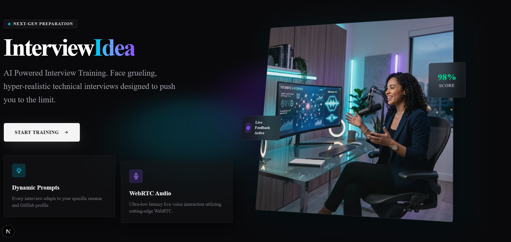

# 🎙️ AI Technical Interviewer

An advanced, real-time AI Interviewer built with Next.js, Supabase, and the Gemini Live API. This application conducts hyper-personalized voice-to-voice technical interviews by synthesizing a candidate's uploaded PDF Resume and GitHub profile. 

After a rigorous, conversational interview, the AI generates a detailed scorecard evaluating the candidate's technical depth, communication, and problem-solving skills.



## ✨ Features

- **Hyper-Personalized Context:** Upload a PDF Resume (up to 5MB) and provide a GitHub username. The system synthesizes this data into a custom system prompt specifically tailored to the target role.
- **Real-Time Voice Streaming:** Utilizes WebSockets and the Web Audio API to stream 16kHz PCM audio directly to the Gemini Live API for a zero-latency conversational experience.
- **Client-Side Transcription:** Leverages the Web Speech API (`webkitSpeechRecognition`) to transcribe the user's audio locally.
- **Automated Scorecard:** When the interview concludes, a secondary LLM pipeline evaluates the full transcript to generate a JSON scorecard detailing strengths, areas for improvement, and competency breakdown.
- **Secure & Robust:** Built-in IP/User rate limiting, strict file-size checks (memory bomb protection), JSON hallucination correctors, and gracefully handled WebSocket drops.

## 🚀 Tech Stack

- **Frontend:** Next.js 14 (App Router), React, Tailwind CSS, GSAP (Animations), Lucide React (Icons).
- **Backend:** Next.js Serverless API Routes (`/api/prepare-prompt`, `/api/evaluate`).
- **Database & Auth:** Supabase (PostgreSQL) with strict Row Level Security (RLS).
- **AI / LLMs:** Google Gemini (`gemini-3.1-flash-live-preview` for voice, `gemini-3.5-flash` for prompt synthesis).
- **Utilities:** `pdf-parse` (CV Extraction), Web Speech API.

## 📋 Prerequisites

Before you begin, ensure you have the following API keys and tools:
1. **Node.js** (v18 or higher)
2. **Supabase Account** (for Database and Auth)
3. **Google Gemini API Key** (from Google AI Studio)

## 🛠️ Local Setup

1. **Clone the repository:**
   ```bash
   git clone https://github.com/hum4nBeing/InterviewIdea.git
   cd InterviewIdea
   ```

2. **Install dependencies:**
   ```bash
   npm install
   ```

3. **Set up environment variables:**
   Create a `.env.local` file in the root of your project and add your keys:
   ```env
   NEXT_PUBLIC_SUPABASE_URL=your_supabase_url
   NEXT_PUBLIC_SUPABASE_ANON_KEY=your_supabase_anon_key
   GEMINI_API_KEY=your_gemini_api_key
   ```

4. **Initialize Supabase (Database Schema):**
   Execute the provided SQL migrations located in `supabase/migrations/` in your Supabase SQL Editor.
   - `00000000000000_init.sql` (Creates core tables and RLS)
   - `20260812000000_phase2_schema.sql` (Adds phase 2 columns)

5. **Run the development server:**
   ```bash
   npm run dev
   ```
   Open [http://localhost:3000](http://localhost:3000) with your browser to start interviewing!

## 🛡️ Security & Architecture

This project is designed with production-grade security:
- **Row Level Security (RLS):** Users can only read and write their own interview transcripts. 
- **Server-Side API Keys:** The Gemini API key is never exposed to the client. It is securely utilized inside Next.js API routes.
- **Anti-Abuse Measures:** In-memory rate limiting prevents API spamming and quota exhaustion.

## 📝 License

This project is licensed under the MIT License.
